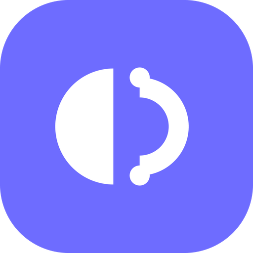
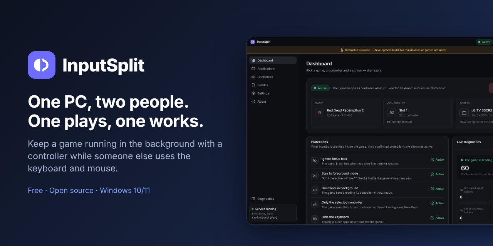
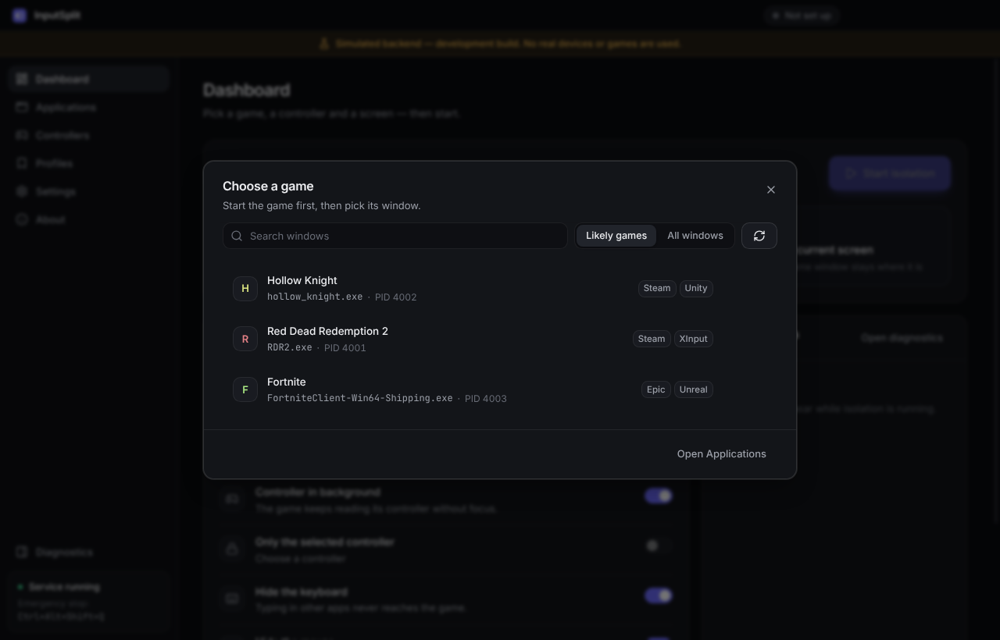
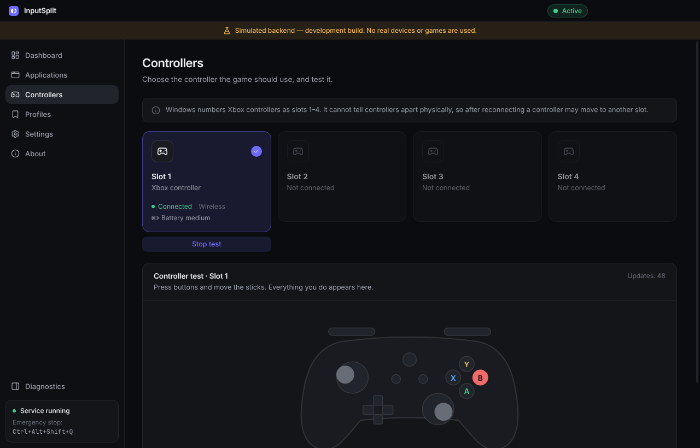
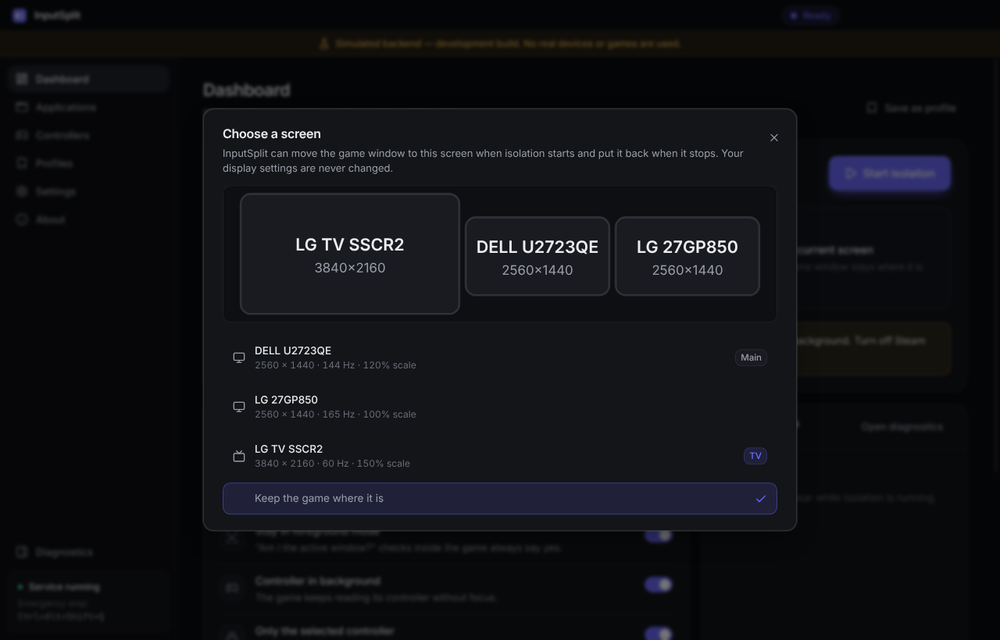
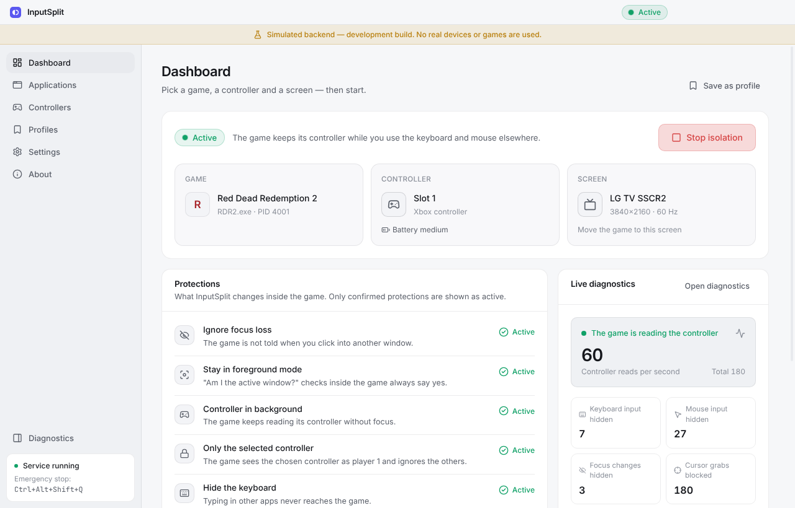

<div align="center">



# InputSplit

**Play on the TV with a controller while someone else keeps working on the same Windows PC.**

Free and open source · Windows 10/11 · MIT License

[**Download InputSplit.exe**](https://github.com/narkotrxll/InputSplit/releases/latest) ·
[Website](https://narkotrxll.github.io/InputSplit/) ·
[Support the author ❤](https://donatello.to/Narkotroll)

</div>



> [!NOTE]
> **Version 0.1.x.** Tested on real Windows by two people at once: one played on the TV with a
> controller while the other kept working on the monitors. InputSplit is made for
> **single-player and offline games** (see [Use responsibly](#use-responsibly)). Per-game
> results go into the [compatibility matrix](docs/COMPATIBILITY.md).

## Is this what you are looking for?

InputSplit is for you if you have run into one of these on Windows:

- **The game pauses when I Alt+Tab** or click on another monitor, and I want it to keep running.
- **The controller stops working when the game window is not focused**, so nobody can play
  while someone else uses the PC.
- **The game reacts to my keyboard and mouse** while I am typing in another window.
- I want **one PC for two people**: one plays on the TV with a gamepad, the other works or
  browses on the monitors with the keyboard and mouse.
- I want to **play a game in the background with a controller** while watching a video,
  chatting or working on a second screen.

## What it does

One computer, two people:

- **Person A** works on two monitors with the keyboard and mouse — VS Code, Chrome, Telegram,
  Alt+Tab, everything as usual.
- **Person B** plays a game on the TV with an Xbox controller.

Normally the game pauses, mutes or stops reading the controller as soon as person A clicks
somewhere else — and a game that thinks it is focused reacts to person A's typing.
InputSplit fixes both, **inside the chosen game only**:

| | |
|---|---|
| 🎮 **Controller keeps working** | The game keeps reading its controller in the background. |
| 🪟 **No pause on focus loss** | The game is never told that another window became active. |
| ⌨️ **Keyboard and mouse stay yours** | The game cannot see typing, mouse movement or clicks. |
| 🖱️ **Cursor protected** | The game cannot re-centre or trap the shared mouse pointer. |
| 🎯 **One controller per game** | The chosen controller becomes the game's player 1. |
| 🕹️ **Most gamepads** | Xbox and other XInput controllers, plus DirectInput and HID gamepads. |
| 🧩 **64-bit and 32-bit games** | Both kinds of games are supported. |
| 🌍 **11 languages** | English, Українська, Русский, Español, Deutsch, Français, Português (Brasil), Polski, Türkçe, 简体中文, 日本語. Uses your Windows language by default; change it in Settings. |
| 📺 **Right screen** | Optionally moves the game window to the TV and puts it back afterwards. If the TV has speakers, the game's sound plays there too, while everything else stays on your usual speakers. |

Pick the game, pick the controller, press **Start isolation**. That's it. A short setup wizard
walks you through it the first time.

Once a game has a profile, it gets even simpler:

- **Add from library** on the Profiles page lists the games installed through Steam, Epic
  Games and GOG Galaxy, so you pick a game instead of hunting for its `.exe`.
- **Play** on a profile (or in the tray menu) starts the game and isolates it as soon as its
  window appears. Profiles can also start isolation **automatically** whenever the game opens.
- **From the couch:** hold **LB + RB + View** for 2 seconds to start or stop isolation. The
  controller vibrates once when isolation is on and twice when it is off.
- **FPS and input latency:** hold **LB + RB + Menu** for 1 second in a game to show or hide
  FPS, frame time and input latency in the corner of that game's screen (windowed and
  borderless games). The latency is measured inside the PC, from the game reading a new
  button press to it handing over the frame; the controller, cable and TV add their own delay
  on top, which software cannot measure.
- **Tray:** closing the window keeps InputSplit in the tray, where you can start a profile,
  stop isolation or quit. It can also **start with Windows**, hidden in the tray.
- Windows **notifications** when isolation starts or ends.
- **Updates:** InputSplit checks GitHub for new versions and installs them for you.
- The game picker marks launchers, online games and games that worked (or not) the last time
  on this PC.
- Each profile shows how long the game has been **played** with InputSplit.
- **Backup:** Settings → Backup exports profiles, settings and play time to a file and imports
  them on another PC.
- **Report a problem** (About or Settings) saves a diagnostics report and opens a GitHub issue
  with the details filled in.
- **Two players:** turn on Settings → Controllers → **Two players** to isolate two games at
  once, each locked to its own controller. The dashboard gets a tab per player, and each
  player's controller shortcut starts or stops their own game. For the **same game on both
  screens**, press **Play** on its profile again: InputSplit starts a second copy for the other
  player with a free controller and screen (if the game allows two copies).

### Controller problems it fixes

The **Controllers** page also helps with the usual gamepad trouble on Windows. Everything
below applies only inside isolated games; the controller and other programs stay unchanged.

- **Double input:** warns when a controller reaches games twice (Steam Input, DS4Windows,
  reWASD and similar) and says what to turn off.
- **Stick drift:** dead zones for each stick and the triggers, with a live readout of how far a
  released stick rests off-centre.
- **Button remapping:** any button can act as another or be turned off (swap A and B in one
  click). **Player order** fixes games that number the controllers the wrong way round.
- **PlayStation and Switch Pro controllers:** DualShock 4, DualSense and Switch Pro
  controllers appear to isolated games as an Xbox controller, without drivers (vibration over
  USB). Off by default.
- **Controller as keyboard:** for games without controller support, buttons, triggers and the
  left stick press keys inside the game (WASD preset in one click), while the shared keyboard
  stays blocked.
- **Warnings on the TV** when the controller disconnects or its battery runs low.
- **Xbox button:** does not open Game Bar over an isolated game (Settings, on by default).
- **Polling rate:** measures how many updates per second the controller sends.

<table>
<tr>
<td></td>
<td></td>
</tr>
<tr>
<td></td>
<td></td>
</tr>
</table>

## How it works (short version)

InputSplit loads a small component (`InputSplitHook64.dll`, or `InputSplitHook32.dll` for
32-bit games) into the game you choose. Inside the game it:

1. swallows the "you lost focus" window messages,
2. answers "yes" when the game asks whether it is the active window,
3. keeps XInput enabled and binds the game's player 1 to the chosen controller, and keeps
   DirectInput and HID (Raw Input) controllers working in the background,
4. hides keyboard and mouse input (messages, key-state polling, Raw Input),
5. ignores attempts to move or confine the cursor.

Nothing outside the game is changed: no global keyboard hooks, no input locking, no display
reconfiguration, no administrator rights. Everything is undone when you press **Stop**.

**Safety net:** if InputSplit crashes, is killed, or you press **Ctrl+Alt+Shift+Q**, the
component inside the game switches itself off immediately and the game behaves normally
again. Details: [docs/ARCHITECTURE.md](docs/ARCHITECTURE.md#3-fail-safe-chain-the-most-important-design-property).

## Use responsibly

Loading code into another program is also how some cheats work. InputSplit:

- **refuses** games protected by anti-cheat systems (Easy Anti-Cheat, BattlEye, Vanguard,
  FACEIT, nProtect, XIGNCODE, …) and games known to ban for it (Counter-Strike 2, Dota 2,
  Team Fortress 2, Deadlock, Roblox), and explains why. This **anti-cheat protection** is on
  by default;
- never tries to hide from an anti-cheat or get around it;
- works reliably only in **single-player / offline** games.

You can turn anti-cheat protection off in **Settings → Safety** if you want to decide for
yourself. InputSplit then shows a warning when you switch it off, and again before every start
of an online game or a game with anti-cheat. Read it carefully: **the game can ban your
account, sometimes days later and permanently**, and some anti-cheats stop the game from
starting or close it anyway. Nothing about how InputSplit works changes, so the anti-cheat sees
exactly what it would see with the protection on. You take that risk yourself.

Because it loads code into a game, InputSplit may be flagged by antivirus software until
releases are code-signed.

## Privacy

InputSplit has no accounts, ads, analytics or telemetry. The only network requests it makes are
update checks and downloads from GitHub (`api.github.com` and the release files on
`github.com`); turn them off in **Settings → Updates**. **Report a problem** saves a report on
your PC and opens a GitHub issue page in your browser; nothing is sent until you submit that
issue yourself.

## Known limitations

- Games that read controllers only through **Windows.Gaming.Input** or **GameInput** (default
  focus policy) do not get controller input in the background — InputSplit detects this and
  shows *Limited support*.
- **Exclusive fullscreen** cannot stay active without focus — use *Borderless Windowed*.
- **Steam Input** may turn the controller into a mouse while the game is in the background —
  disable Steam Input for that game.
- Games running as administrator need InputSplit to run as administrator too.
- 32-bit games and DirectInput or HID (Raw Input) controllers are newer and have been tried on
  fewer games than XInput controllers in 64-bit games (see the [roadmap](docs/ROADMAP.md)).
- Windows has one keyboard focus; InputSplit makes the game not *need* it, it cannot create a
  second one.
- **Controller as keyboard** works in games that read keys from window messages or key-state
  queries, not in games that read the keyboard through Raw Input or DirectInput.
- A **second copy of the same game** starts only if the game allows it; InputSplit does not
  change the game to make it.

## Install

Download `InputSplit.exe` from the
[latest release](https://github.com/narkotrxll/InputSplit/releases/latest) and run it. No
administrator rights are needed. After that InputSplit keeps itself up to date: it downloads
new versions in the background and installs them when you restart it (Settings → Updates).

With [Scoop](https://scoop.sh):

```powershell
scoop bucket add inputsplit https://github.com/narkotrxll/InputSplit
scoop install inputsplit/inputsplit
```

Windows SmartScreen or an antivirus may warn about the installer because it is not code-signed
yet. Choose **More info → Run anyway** if you downloaded it from the link above.

## Build from source

Requirements: Node.js 22+, and for the native layer on Windows: Visual Studio 2022 (or Build
Tools) with the C++ workload and CMake.

```powershell
npm ci
npm run build:native   # MSVC build of the helper and hook DLL → resources/native
npm run dev            # run the app with hot reload
npm run dist:win       # installer in dist/
```

Developing the UI on macOS/Linux:

```bash
npm ci
npm run dev:simulated  # simulated backend, development builds only, clearly labelled in the UI
```

Checks: `npm run lint`, `npm run typecheck`, `npm test`. The native code can also be
cross-compiled on Linux with MinGW (`npm run build:native`) for compile checks.

Releases: a new release is built and published automatically on every push to `main` (version
`<major>.<minor>.<n>`: major.minor comes from `package.json`, `n` counts up). To start a new line,
bump `version` in `package.json` (e.g. to `0.2.0`); to release a specific version, push a tag such
as `v0.2.0`.

## Project structure

```
native/       C++ (CMake): hook DLL, helper process, probe test app
src/shared/   domain model, typed IPC contract, status logic (shared by main and UI)
src/main/     Electron main process: helper supervision, session state machine, storage
src/preload/  the minimal, whitelisted bridge between UI and main
src/renderer/ Vue 3 UI (Pinia, Reka UI, Tailwind CSS, Lucide)
docs/         research, architecture, roadmap, test plan, compatibility matrix
```

- [Research: NoFocusLoss, ProtoInput, Windows input APIs](docs/RESEARCH.md)
- [Architecture](docs/ARCHITECTURE.md)
- [Roadmap and MVP criteria](docs/ROADMAP.md)
- [Testing on real hardware](docs/TESTING.md)

## Credits

InputSplit stands on the shoulders of
[NoFocusLoss](https://github.com/araghon007/NoFocusLoss) (focus-loss technique, public domain)
and [ProtoInput](https://github.com/Ilyaki/ProtoInput) (input redirection techniques, MIT),
and uses [MinHook](https://github.com/TsudaKageyu/minhook) and
[nlohmann/json](https://github.com/nlohmann/json). See
[THIRD_PARTY_NOTICES.md](THIRD_PARTY_NOTICES.md).

## Support

InputSplit is free. If it saves your evenings on the couch, you can
[support the author on Donatello ❤](https://donatello.to/Narkotroll). Cards from most countries work. There is also a
**Support the author** button in the app's sidebar.

## License

[MIT](LICENSE) © 2026 narkotrxll
