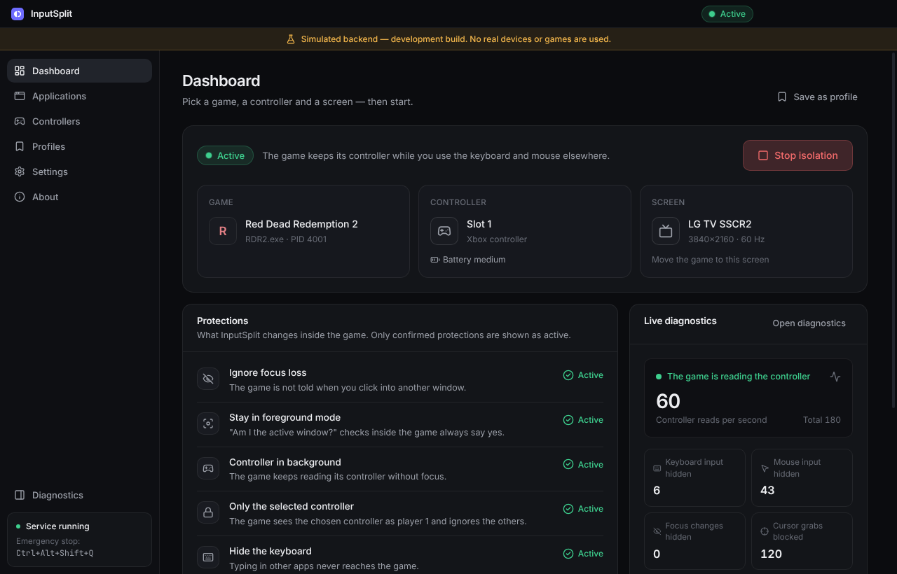

<div align="center">


# InputSplit

**Play on the TV with a controller while someone else keeps working on the same Windows PC.**

Free and open source · Windows 10/11 · MIT License

</div>



> [!IMPORTANT]
> **Status: early preview (0.1.0).** The app, the native helper and the hook DLL are
> implemented and their plumbing is tested, but behaviour with real games has **not yet been
> verified on Windows hardware**. Screenshots come from a development build with a simulated
> backend. See [docs/TESTING.md](docs/TESTING.md) and the
> [compatibility matrix](docs/COMPATIBILITY.md) before relying on it.

## What it does

One computer, two people:

- **Person A** works on two monitors with the keyboard and mouse — VS Code, Chrome, Telegram,
  Alt+Tab, everything as usual.
- **Person B** plays a game on the TV with an Xbox controller.

Normally the game pauses, mutes or stops reading the controller as soon as person A clicks
somewhere else — and a game that thinks it is focused reacts to person A's typing.
InputSplit fixes both, **inside the chosen game only**:

| | |
|---|---|
| 🎮 **Controller keeps working** | The game keeps reading its controller in the background. |
| 🪟 **No pause on focus loss** | The game is never told that another window became active. |
| ⌨️ **Keyboard and mouse stay yours** | The game cannot see typing, mouse movement or clicks. |
| 🖱️ **Cursor protected** | The game cannot re-centre or trap the shared mouse pointer. |
| 🎯 **One controller per game** | The chosen controller becomes the game's player 1. |
| 🌍 **11 languages** | English, Українська, Русский, Español, Deutsch, Français, Português (Brasil), Polski, Türkçe, 简体中文, 日本語. Follows the Windows language by default. |
| 📺 **Right screen** | Optionally moves the game window to the TV and puts it back afterwards. |

Pick the game, pick the controller, press **Start isolation**. That's it.

Once a game has a profile, it gets even simpler:

- **Play** on a profile (or in the tray menu) starts the game and isolates it as soon as its
  window appears. Profiles can also start isolation **automatically** whenever the game opens.
- **From the couch:** hold **LB + RB + View** for 2 seconds to start or stop isolation. The
  controller vibrates once when isolation is on and twice when it is off.
- **Start with Windows** (hidden in the tray), Windows notifications when isolation starts or
  ends, and a built-in **update check** that installs new versions from GitHub on one click.
- The game picker marks launchers, online games and games that worked (or not) the last time
  on this PC.

<table>
<tr>
<td></td>
<td></td>
</tr>
<tr>
<td></td>
<td></td>
</tr>
</table>

## How it works (short version)

InputSplit loads a small component (`InputSplitHook64.dll`) into the game you choose. Inside
the game it:

1. swallows the "you lost focus" window messages,
2. answers "yes" when the game asks whether it is the active window,
3. keeps XInput enabled and binds the game's player 1 to the chosen controller,
4. hides keyboard and mouse input (messages, key-state polling, Raw Input),
5. ignores attempts to move or confine the cursor.

Nothing outside the game is changed: no global keyboard hooks, no input locking, no display
reconfiguration, no administrator rights. Everything is undone when you press **Stop**.

**Safety net:** if InputSplit crashes, is killed, or you press **Ctrl+Alt+Shift+Q**, the
component inside the game switches itself off immediately and the game behaves normally
again. Details: [docs/ARCHITECTURE.md](docs/ARCHITECTURE.md#3-fail-safe-chain-the-most-important-design-property).

## Use responsibly

Loading code into another program is also how some cheats work. InputSplit:

- **refuses** games protected by anti-cheat systems (Easy Anti-Cheat, BattlEye, Vanguard,
  FACEIT, nProtect, XIGNCODE, …) and explains why — it never tries to hide from them;
- is meant for **single-player / offline** games;
- may be flagged by antivirus software until releases are code-signed.

## Known limitations

- Games that read controllers only through **Windows.Gaming.Input** or **GameInput** (default
  focus policy) do not get controller input in the background — InputSplit detects this and
  shows *Limited support*.
- **Exclusive fullscreen** cannot stay active without focus — use *Borderless Windowed*.
- **Steam Input** may turn the controller into a mouse while the game is in the background —
  disable Steam Input for that game.
- **32-bit games**, DirectInput gamepads in background, and games running as administrator are
  not supported yet (see the [roadmap](docs/ROADMAP.md)).
- Windows has one keyboard focus; InputSplit makes the game not *need* it, it cannot create a
  second one.

## Install

Download `InputSplit-Setup-<version>.exe` from
[Releases](https://github.com/narkotrxll/InputSplit/releases) (once published) and run it. No
administrator rights are needed.

Until then, every CI run on Windows produces the installer and the native test binaries as
build artifacts (Actions → latest run → *inputsplit-installer* / *inputsplit-native*).

## Build from source

Requirements: Node.js 22+, and for the native layer on Windows: Visual Studio 2022 (or Build
Tools) with the C++ workload and CMake.

```powershell
npm ci
npm run build:native   # MSVC build of the helper and hook DLL → resources/native
npm run dev            # run the app with hot reload
npm run dist:win       # installer in dist/
```

Developing the UI on macOS/Linux:

```bash
npm ci
npm run dev:simulated  # simulated backend, development builds only, clearly labelled in the UI
```

Checks: `npm run lint`, `npm run typecheck`, `npm test`. The native code can also be
cross-compiled on Linux with MinGW (`npm run build:native`) for compile checks.

## Project structure

```
native/       C++ (CMake): hook DLL, helper process, probe test app
src/shared/   domain model, typed IPC contract, status logic (shared by main and UI)
src/main/     Electron main process: helper supervision, session state machine, storage
src/preload/  the minimal, whitelisted bridge between UI and main
src/renderer/ Vue 3 UI (Pinia, Reka UI, Tailwind CSS, Lucide)
docs/         research, architecture, roadmap, test plan, compatibility matrix
```

- [Research: NoFocusLoss, ProtoInput, Windows input APIs](docs/RESEARCH.md)
- [Architecture](docs/ARCHITECTURE.md)
- [Roadmap and MVP criteria](docs/ROADMAP.md)
- [Testing on real hardware](docs/TESTING.md)

## Credits

InputSplit stands on the shoulders of
[NoFocusLoss](https://github.com/araghon007/NoFocusLoss) (focus-loss technique, public domain)
and [ProtoInput](https://github.com/Ilyaki/ProtoInput) (input redirection techniques, MIT),
and uses [MinHook](https://github.com/TsudaKageyu/minhook) and
[nlohmann/json](https://github.com/nlohmann/json). See
[THIRD_PARTY_NOTICES.md](THIRD_PARTY_NOTICES.md).

## License

[MIT](LICENSE) © 2026 narkotrxll
